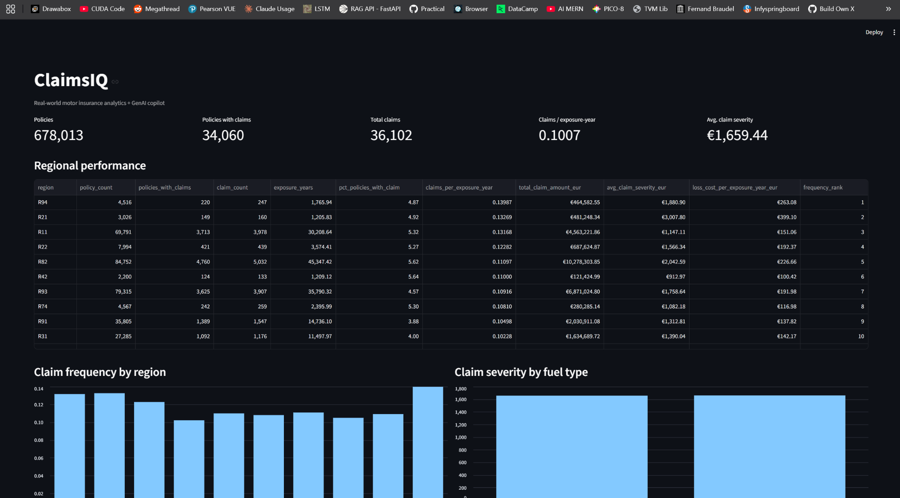
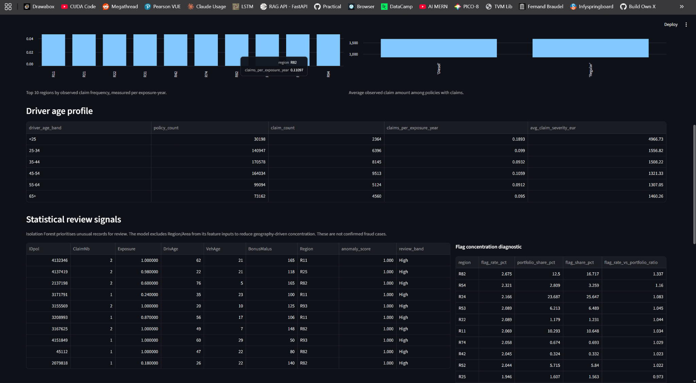
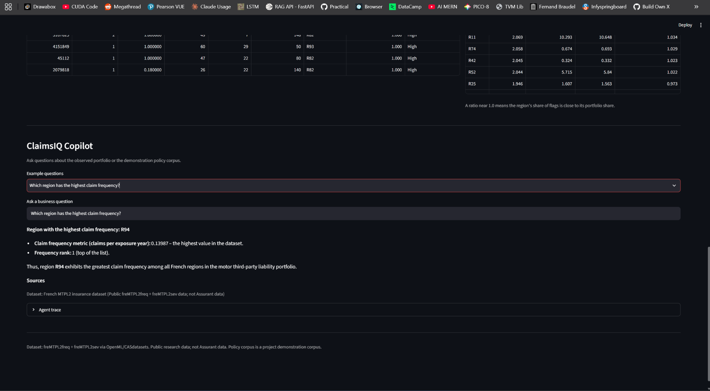
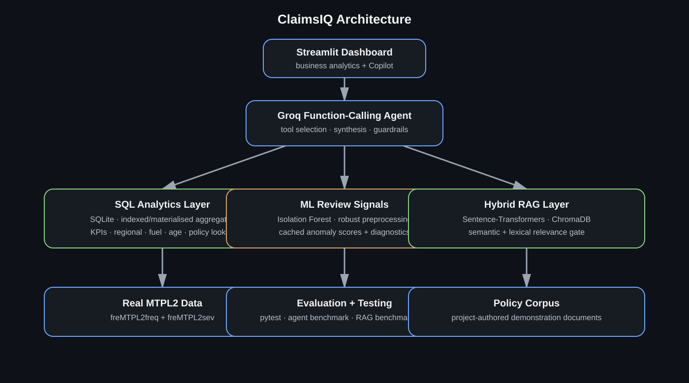

# ClaimsIQ

**AI-powered insurance analytics and GenAI copilot**

ClaimsIQ is an end-to-end data-science and agentic-AI application built on the public French Motor Third-Party Liability (MTPL2) insurance datasets. It combines **real insurance data, analytical SQL, unsupervised ML, gated policy-document RAG, controlled LLM tool calling, a retrieval benchmark on 2,000 real customer questions, and a business-facing Streamlit dashboard**.

> **Important:** ClaimsIQ does **not** use Assurant data. The MTPL2 source is public research data from an unknown private insurer. The policy documents used for RAG are project-authored demonstration documents.



## Why I built it

The project is designed around a practical enterprise AI workflow rather than a standalone model demo:

```text
Real insurance data
        ↓
Data cleaning + claim aggregation
        ↓
SQL analytics + materialised business metrics
        ↓
Isolation Forest review signals
        ↓
Hybrid policy-document RAG
        ↓
Read-only LLM tool calling
        ↓
Grounded business answer + source trace
        ↓
Automated evaluation
```

The goal is to keep **data access, business logic, model output, and LLM orchestration separate and testable**.

## Highlights

### Real insurance dataset

ClaimsIQ ingests the public `freMTPL2freq` and `freMTPL2sev` datasets from the CASdatasets/OpenML ecosystem. The runtime dataset contains **678,013 policy records** and associated claim-level information. The raw/downloaded dataset and generated SQLite database are intentionally **not committed to GitHub**; `scripts/bootstrap_real.py` recreates them locally from the public source.

The pipeline validates identifiers, exposure and claim amounts, aggregates claim severity by policy, and produces a modelling/analytics table.

### SQL analytics

The application exposes reusable SQL-backed business metrics including:

- portfolio KPIs
- claim frequency per exposure-year
- average claim severity
- loss cost per exposure-year
- regional comparisons
- fuel-type comparisons
- driver-age analysis
- individual policy lookup

The regional ranking query includes a SQL `DENSE_RANK()` window function. High-traffic summaries are materialised into small indexed tables so conversational queries do not repeatedly scan the full dataset.


### Unsupervised anomaly detection

ClaimsIQ uses **Isolation Forest** to prioritise unusual policies for analyst review.

The preprocessing pipeline applies log transforms to highly skewed numeric variables and robust scaling, while excluding `Region` and `Area` from model inputs to reduce geography-driven concentration. Results are persisted as indexed anomaly signals and regional diagnostics.

These are **statistical review signals, not fraud labels or automated claim decisions**.



### Retrieval

The copilot's `search_policy` tool searches a small project-authored policy corpus, embedded with Sentence-Transformers and indexed in ChromaDB, behind a relevance gate that accepts a result only when semantic similarity is backed by lexical evidence.

Four documents cannot show whether retrieval works, so retrieval is also measured on **InsuranceQA**: 27,413 answers written by insurance professionals and 2,000 test questions from real users, with the correct answers labelled by the dataset's authors. Four retrievers are compared on the same questions:

```text
BM25 keyword search
Embedding search (three small models, one chosen on validation data)
Hybrid: reciprocal rank fusion of the two
Hybrid + cross-encoder reranking
```

The copilot's original relevance gate is also tested on questions the index genuinely cannot answer. Results are below and in [`docs/retrieval.md`](docs/retrieval.md).

### Controlled Agentic AI

With a Groq API key configured, the Copilot uses model-selected function calling against an explicit set of read-only business tools.

The agent can call tools for:

```text
portfolio KPIs
regional analytics
fuel analytics
driver-age analytics
individual policy lookup
anomaly review
anomaly-region diagnostics
policy retrieval
```

There is **no arbitrary SQL tool**. The application dispatches only allow-listed operations with validated parameters.

For independent multi-tool requests, the application can execute tool calls concurrently before asking the model to synthesize the final answer.



## Evaluation

The agent benchmark is project-authored. Retrieval is measured on a public dataset with outside labels.

### Agent benchmark

The current benchmark contains **26 cases**, including single-tool and multi-tool questions. The v6 run produced:

| Metric | Result |
|---|---:|
| Tool exact-match rate | **100%** |
| Tool-set match rate | **100%** |
| Tool recall | **100%** |
| Multi-tool set match | **100%** |
| Source presence | **96.2%** |
| Mean tool execution time | **29 ms** |
| Mean end-to-end latency | **13.7 s** |
| P95 end-to-end latency | **27.5 s** |

The tool-routing metrics measure implementation behaviour on this benchmark. The deterministic answer-fact checker reported **88.5%** and identified three cases for manual inspection, so that figure is intentionally **not presented as semantic answer accuracy**.

### Retrieval benchmark

<!-- retrieval:start -->
| Measure | Result | Detail |
|---|---|---|
| Benchmark | 27,413 expert answers, 2,000 real test questions | InsuranceQA V2, labels from the dataset authors |
| BM25: correct answer in top 5 | 41.2% (39.1% to 43.4%) | MRR@10 0.301, 2.3 ms per query on CPU |
| Hybrid + rerank: correct answer in top 5 | 59.9% (57.8% to 62.1%) | +18.7 pts (+16.8 to +20.8) vs BM25, 87 ms per query on NVIDIA GeForce RTX 4070 Laptop GPU |
| Original relevance gate on real unanswerable questions | refused 31% | and refused 1% of answerable ones |
| Tuned gate on the same questions | refused 86% | and refused 10% of answerable ones |
<!-- retrieval:end -->

Every setting was chosen on the validation split, and the test split was used only to report. Full tables, paired comparisons, per-domain results, failure examples, and limits are in [`docs/retrieval.md`](docs/retrieval.md).

The earlier 20-question test over the four project documents is retired. With four documents, returning any three already scores 75% Recall@3 by chance, so its 100% results said nothing about ranking.

## Example questions

```text
Which region has the highest claim frequency?
Compare claim severity for Diesel and Regular vehicles.
What is the claim frequency across driver age bands?
Are anomaly flags concentrated in any region?
Show me the most unusual policies.
Look up policy 4132346.
What does the policy corpus say about accidental damage coverage?
Which region has the highest claim frequency, and how does its severity compare with the portfolio average?
```

## Architecture



See [`docs/architecture.md`](docs/architecture.md) for the layer-by-layer design.

## Tech stack

**Python · Pandas · NumPy · SQL/SQLite · scikit-learn · BM25 · Sentence-Transformers · cross-encoders · ChromaDB · Groq LLMs · Streamlit · pytest · Docker · GitHub Actions**

## Quickstart

### 1. Create the environment

```powershell
python -m venv .venv
.\.venv\Scripts\Activate.ps1
pip install -r requirements.txt
```

### 2. Configure the LLM

Copy `.env.example` to `.env` and add your Groq key:

```env
GROQ_API_KEY=gsk_...
GROQ_MODEL=openai/gpt-oss-20b
GROQ_REASONING_EFFORT=low
GROQ_MAX_COMPLETION_TOKENS=1024
```

Never commit `.env`.

### 3. Build the real dataset

```powershell
python scripts/bootstrap_real.py
```

For an already-built database, refresh materialised analytics/anomaly tables with:

```powershell
python scripts/refresh_anomaly_cache.py
```

### 4. Run the dashboard

```powershell
python -m streamlit run app/streamlit_app.py
```

Open `http://localhost:8501`.

### 5. Run tests

```powershell
pytest -q
```

### 6. Run evaluations

```powershell
python scripts/run_eval.py
python -m src.retrieval build          # download InsuranceQA, tune BM25 on validation data
python -m src.retrieval eval           # BM25 and abstention on test, CPU only
python -m src.retrieval eval --dense   # embeddings, fusion, reranking; best on a GPU
python -m src.retrieval check          # BM25 must reproduce the committed numbers
```

The agent benchmark reports model/API time separately from tool execution time. The RAG benchmark warms the embedding model before measuring the individual cases.

## Project structure

```text
ClaimsIQ/
├── app/
│   └── streamlit_app.py
├── data/
│   └── README.md
├── docs/
│   ├── architecture.md
│   ├── architecture.svg
│   ├── retrieval.md
│   └── screenshots/
├── eval/
│   ├── benchmark.json
│   └── retrieval/
├── scripts/
│   ├── bootstrap_real.py
│   ├── refresh_anomaly_cache.py
│   ├── refresh_analytics_cache.py
│   ├── eval_rag.py
│   └── run_eval.py
├── src/
│   ├── agent/
│   ├── analytics/
│   ├── data/
│   ├── evaluation/
│   ├── ml/
│   ├── rag/
│   └── retrieval/
├── tests/
├── Dockerfile
├── docker-compose.yml
├── requirements.txt
└── .github/workflows/ci.yml
```

## Engineering choices

### Why materialise analytics?

The original prototype repeatedly computed summaries over the full 678K-row policy table. ClaimsIQ now materialises KPI, regional, fuel, age and anomaly summaries into indexed tables. This reduced the average application-side tool execution time to **29 ms** in the v6 benchmark.

### Why restrict the agent?

A generic SQL agent would make it difficult to reason about permissions, reproducibility and safe behaviour. ClaimsIQ instead exposes explicit business operations with structured inputs and no arbitrary SQL execution.

### Why evaluate routing separately from language quality?

Tool selection, retrieval and generated-language quality are different problems. ClaimsIQ therefore reports deterministic routing/retrieval measurements separately and explicitly flags answer-fact cases for manual inspection.

## Limitations

- MTPL2 is **motor third-party liability** data, not device-protection data.
- The policy corpus is project-authored demonstration material, not an insurer's proprietary policy corpus.
- Isolation Forest is unsupervised and produces review signals, not confirmed fraud labels.
- The agent benchmark is a small project-authored set.
- Retrieval is measured on InsuranceQA, a public Q&A dataset, not on an insurer's policy wording.
- The copilot still searches the four demonstration documents. The benchmarked retrievers are not yet wired into it.
- LLM response time depends on the selected model and API conditions.
- The application is a portfolio/research demonstration, not a production underwriting, pricing or claims-decision engine.

## References

- CASdatasets: French Motor Third-Party Liability datasets (`freMTPL2freq`, `freMTPL2sev`)
- OpenML dataset ecosystem
- Groq tool-calling / reasoning documentation
- Feng et al., *Applying Deep Learning to Answer Selection: A Study and an Open Task*, ASRU 2015 (InsuranceQA, used for research only)
